# JobRadar — Tracker Deterministico di Candidature & Promemoria Colloqui

[Italiano](README.it.md) · [English](README.md) · [Architettura](docs/ARCHITECTURE.md) · [Lancio & SEO](docs/LAUNCH.md)

[](LICENSE)
[](https://github.com/MRJonam91/JobRadar/actions/workflows/ci.yml)
[](package.json)
[](package.json)
[](https://github.com/sponsors/MRJonam91)

Tracker locale e privacy-first per monitorare offerte di lavoro, stati delle candidature, colloqui tecnici, scadenze d'offerta e promemoria di follow-up con zero dipendenze esterne.

<p align="center">
  
</p>

---

## 🎯 Il Problema

Durante la ricerca di una nuova opportunità professionale, i dati delle candidature si frammentano tra decine di piattaforme, email, cartelle e fogli di calcolo:
- **Pipeline Dispersa**: Posizioni salvate su LinkedIn, annunci su Indeed, candidature dirette sui siti aziendali senza uno stato unificato.
- **Follow-up Dimenticati**: Candidature senza risposta in cui ci si dimentica di inviare un promemoria garbato, o posizioni ormai da considerare come "ghosted".
- **Stime Salariali Arbitrarie**: Retribuzioni stimate a memoria senza una traccia verificabile di quale fosse la cifra dichiarata nell'annuncio o dal recruiter.
- **Disallineamento dei CV**: Difficoltà nel ricordare quale versione del CV o quale lettera di presentazione è stata inviata a ciascuna azienda.

---

## 🛡️ La Soluzione: JobRadar

JobRadar trasforma la gestione della ricerca di lavoro in un registro unico deterministico locale (`jobradar.json`):
- **100% Locale & Privacy-First**: Funziona interamente offline sul tuo disco. Zero tracciamento, nessun dato condiviso con cloud o recruiter.
- **Macchina a Stati Rigorosa**: Pipeline deterministica: `discovered` ➔ `applied` ➔ `screening` ➔ `interviewing` ➔ `offer_received` ➔ `accepted` / `rejected` / `withdrawn` / `ghosted`.
- **Promemoria Intelligenti & Follow-up**:
  - Evidenzia candidature ferme (**stale applications**, >10 giorni di silenzio) per sollecitare un riscontro.
  - Segnala posizioni abbandonate da oltre 30 giorni come probabile *ghosting*.
  - Monitora le **scadenze di accettazione offerte** (`offerDeadline`) con countdown dei giorni rimanenti.
- **Obbligo di Fonte Salariale Verificabile**: In conformità alle specifiche di progetto, qualsiasi cifra economica richiede l'indicazione esplicita della fonte (`job_posting`, `recruiter_email`, `offer_letter`), impedendo stime fantasiose.
- **Esportazione Multi-Formato**:
  - Riepiloghi completi della pipeline in formato Markdown.
  - Sincronizzazione automatica tramite file standard RFC 5545 iCalendar (`.ics`) con Google Calendar, Apple Calendar e Outlook.
  - Esportazione tabellare CSV per fogli di calcolo.
- **Zero Dipendenze di Runtime Esterne**: Solo librerie standard di Node.js (`node:fs`, `node:path`, `node:crypto`).

---

## 🚀 Avvio Rapido&#x200B;

Installazione e compilazione in locale:

```bash
git clone https://github.com/MRJonam91/JobRadar.git
cd JobRadar
npm install
npm run build
```

Esecuzione dei comandi da terminale:

```bash
# 1. Inizializza un registro locale vuoto
node dist/cli/index.js init

# 2. Registra una nuova candidatura con stipendio verificato
node dist/cli/index.js add \
  --company "Acme Cloud" \
  --role "Staff Platform Engineer" \
  --workplace remote \
  --status applied \
  --cv "cv-platform-2026-v3" \
  --salary-min 95000 \
  --salary-max 115000 \
  --salary-source "job_posting_public_range"

# 3. Controlla promemoria di follow-up e colloqui imminenti
node dist/cli/index.js remind

# 4. Consulta le statistiche del funnel di selezione
node dist/cli/index.js stats

# 5. Esporta scadenze e colloqui in formato iCalendar (.ics)
node dist/cli/index.js export --format ical --out calendari.ics
```

---

## 💻 Comandi CLI & Opzioni

| Comando | Descrizione | Esempio |
|---|---|---|
| `init` | Inizializza un nuovo file `jobradar.json` | `jobradar init` |
| `add` | Registra una candidatura (manuale o `--from-file`) | `jobradar add --from-file annuncio.html --url "https://..."` |
| `parse` | Estrae metadati, retribuzione e skill da testo/HTML | `jobradar parse --file annuncio.txt` |
| `audit` | Verifica compatibilità con criteri target (Reverse Match) | `jobradar audit stripe-2026` |
| `diff` | Confronto riga per riga tra snapshot di annunci | `jobradar diff stripe-2026 --file annuncio-aggiornato.txt` |
| `list` | Mostra l'elenco tabellare (`--remote`, `--sort salary`) | `jobradar list --status applied --remote` |
| `board` | Mostra la visuale Kanban board da terminale | `jobradar board` |
| `show <id>` | Mostra la scheda dettagliata di una candidatura | `jobradar show stripe-2026` |
| `status` | Aggiorna lo stato nella pipeline di selezione | `jobradar status stripe-2026 interviewing --notes "Superato primo screen"` |
| `stage` | Gestisce i round di colloquio (`add`, `result`) | `jobradar stage add stripe-2026 --name "System Design" --date "2026-11-20"` |
| `remind` | Mostra avvisi, aggiunge o completa promemoria (`add`, `done`) | `jobradar remind done stripe-2026 rem-1` |
| `gap` | Analizza lo skill gap rispetto al profilo CareerVault | `jobradar gap stripe-2026 --career ../CareerVault/career.json` |
| `stats` | Calcola tassi di risposta, colloqui e offerte | `jobradar stats` |
| `import` | Importa candidature in blocco da file CSV | `jobradar import --csv candidature.csv` |
| `export` | Esporta il registro (`html`, `markdown`, `ical`, `csv`, `json`) | `jobradar export --format html --out report.html` |
| `remove` | Elimina una candidatura dal registro | `jobradar remove stripe-2026` |
| `doctor` | Verifica l'integrità del ledger e conformità schema | `jobradar doctor` |

---

## 📦 Architettura Zero Dipendenze

JobRadar è sviluppato con zero librerie esterne di terze parti a runtime:
- Scritto in TypeScript moderno conforme a ECMAScript 2023.
- Utilizza esclusivamente moduli nativi di Node.js (`node:fs`, `node:path`, `node:crypto`, `node:test`).
- Codice core conciso, rigorosamente mantenuto sotto le 1.500 righe per massima verificabilità.

---

## 💖 Sostegno & Donazioni

Se **JobRadar** ti aiuta a fare ordine nelle tue candidature e a trovare la tua prossima posizione, considera di sostenere lo sviluppo:

- **GitHub Sponsors**: [github.com/sponsors/MRJonam91](https://github.com/sponsors/MRJonam91)
- **Ko-fi**: [ko-fi.com/mrjonam](https://ko-fi.com/mrjonam)
- **Buy Me a Coffee**: [buymeacoffee.com/mrjonam](https://buymeacoffee.com/mrjonam)
- **PayPal**: [paypal.me/manorollo](https://paypal.me/manorollo)

---

## 📄 Licenza & Attribuzione

- **Codice Sorgente**: [Apache-2.0](LICENSE) — Copyright 2026 Manoj Rollo (MRJonam91). Consulta [NOTICE](NOTICE).
- **Documentazione**: [Creative Commons BY-SA 4.0](https://creativecommons.org/licenses/by-sa/4.0/).
- **Schemi e Fixtures**: [CC0-1.0 Public Domain](https://creativecommons.org/publicdomain/zero/1.0/).
- Motivazioni dettagliate in [LICENSING.md](LICENSING.md).
