# JobRadar — Deterministic Job Application Tracker & Reminder Engine

[Italiano](README.it.md) · [English](README.md) · [Architecture](docs/ARCHITECTURE.md) · [Launch & SEO](docs/LAUNCH.md)

[](LICENSE)
[](https://github.com/MRJonam91/JobRadar/actions/workflows/ci.yml)
[](package.json)
[](package.json)
[](https://github.com/sponsors/MRJonam91)

Deterministic job application tracker, interview stage monitor, and follow-up reminder engine: local-first, privacy-respecting, zero-dependency.

<p align="center">
  
</p>

---

## 🎯 The Problem

When looking for new career opportunities, application data quickly scatters across portals, emails, spreadsheets, and files:
- **Scattered Pipelines**: Job postings saved on LinkedIn, Indeed, Otta, and company portals with no unified status.
- **Forgotten Follow-ups**: Applications languish without replies; candidates forget when to send a polite check-in or when a position is effectively ghosted.
- **Unverifiable Claims & Estimates**: Vague compensation ranges without verifiable records of who stated them or where they were posted.
- **Résumé Drift**: Losing track of exactly which tailored CV revision or portfolio was submitted to which employer.

---

## 🛡️ The Solution: JobRadar

JobRadar provides a deterministic, local-first **Single Source of Truth** (`jobradar.json`) for your entire career search pipeline:
- **Local & Privacy-First**: 100% offline. Zero recruiter tracking, telemetry, or third-party cloud synchronization.
- **Stage Progression Engine**: Strict state machine tracking: `discovered` ➔ `applied` ➔ `screening` ➔ `interviewing` ➔ `offer_received` ➔ `accepted` / `rejected` / `withdrawn` / `ghosted`.
- **Proactive Follow-up Reminders**:
  - Highlights **stale applications** (>10 days without interaction) prompting timely check-ins.
  - Flags long-inactive postings (>30 days) as likely ghosted.
  - Monitors **offer expiration deadlines** so decision windows are never missed.
- **Zero Speculative Numbers**: Enforces that any recorded compensation includes an auditable, verifiable source (`job_posting`, `recruiter_email`, `offer_letter`).
- **Multi-Sink Exporting**:
  - Interactive standalone HTML dashboard with Kanban columns and dark/light mode.
  - Comprehensive Markdown pipeline reviews.
  - Standard RFC 5545 iCalendar (`.ics`) schedules for Google Calendar, Apple Calendar, and Microsoft Outlook.
  - CSV files for spreadsheet reporting with bi-directional import.
- **Posting Parser & Job Git Diff**:
  - Ingest raw posting text or HTML OpenGraph metadata automatically.
  - Track changes in requirements and compensation between job description revisions.
- **Reverse Job Match & Target Audit**:
  - Evaluate compensation, workplace mode, and role fit against your personal criteria.
- **Zero External Runtime Dependencies**: Standard library only (`node:fs`, `node:path`, `node:crypto`).

---

## 🚀 Quick Start&#x200B;

Install and build locally:

```bash
git clone https://github.com/MRJonam91/JobRadar.git
cd JobRadar
npm install
npm run build
```

Run CLI commands directly:

```bash
# 1. Initialize a new local ledger
node dist/cli/index.js init

# 2. Add an application with verifiable salary
node dist/cli/index.js add \
  --company "Acme Cloud" \
  --role "Staff Platform Engineer" \
  --workplace remote \
  --status applied \
  --cv "cv-platform-2026-v3" \
  --salary-min 95000 \
  --salary-max 115000 \
  --salary-source "job_posting_public_range"

# 3. Check follow-up reminders and upcoming stages
node dist/cli/index.js remind

# 4. View pipeline conversion metrics
node dist/cli/index.js stats

# 5. Export reminders and interviews to iCalendar (.ics)
node dist/cli/index.js export --format ical --out interviews.ics
```

---

## 💻 CLI Commands & Options

| Command | Description | Example |
|---|---|---|
| `init` | Initialize an empty `jobradar.json` file | `jobradar init` |
| `add` | Register a new job application (manual or `--from-file`) | `jobradar add --from-file posting.html --url "https://..."` |
| `parse` | Extract metadata, salary and skills from job text/HTML | `jobradar parse --file posting.txt` |
| `audit` | Audit application against target criteria (Reverse Match) | `jobradar audit stripe-2026` |
| `diff` | Line-by-line diff between posting snapshots | `jobradar diff stripe-2026 --file updated.txt` |
| `list` | Show tabular summary (`--remote`, `--sort salary`) | `jobradar list --status applied --remote` |
| `board` | Render visual ASCII/Unicode Kanban board | `jobradar board` |
| `show <id>` | Display comprehensive card for an application | `jobradar show stripe-2026` |
| `status` | Advance application lifecycle status | `jobradar status stripe-2026 interviewing --notes "Passed call"` |
| `stage` | Manage interview rounds (`add`, `result`) | `jobradar stage add stripe-2026 --name "System Design" --date "2026-11-20"` |
| `remind` | Show alerts, or add/complete follow-ups (`add`, `done`) | `jobradar remind done stripe-2026 rem-1` |
| `gap` | Calculate skill match and gap with CareerVault | `jobradar gap stripe-2026 --career ../CareerVault/career.json` |
| `stats` | Calculate conversion funnel metrics & rates | `jobradar stats` |
| `import` | Bulk import applications from CSV file | `jobradar import --csv applications.csv` |
| `export` | Export ledger (`html`, `markdown`, `ical`, `csv`, `json`) | `jobradar export --format html --out report.html` |
| `remove` | Delete an application from the ledger | `jobradar remove stripe-2026` |
| `doctor` | Audit ledger integrity & schema compliance | `jobradar doctor` |

---

## 📦 Zero-Dependency Architecture

JobRadar is engineered with zero third-party runtime dependencies:
- Written in TypeScript targeting ECMAScript 2023.
- Utilizes native Node.js APIs (`node:fs`, `node:path`, `node:crypto`, `node:test`).
- Minimal footprint with core logic strictly under 1,500 lines of code.

---

## 💖 Support & Donations

If **JobRadar** helps you stay organized and land your next role, consider supporting ongoing development:

- **GitHub Sponsors**: [github.com/sponsors/MRJonam91](https://github.com/sponsors/MRJonam91)
- **Ko-fi**: [ko-fi.com/mrjonam](https://ko-fi.com/mrjonam)
- **Buy Me a Coffee**: [buymeacoffee.com/mrjonam](https://buymeacoffee.com/mrjonam)
- **PayPal**: [paypal.me/manorollo](https://paypal.me/manorollo)

---

## 📄 License & Attribution

- **Source Code**: [Apache-2.0](LICENSE) — Copyright 2026 Manoj Rollo (MRJonam91). See [NOTICE](NOTICE).
- **Documentation**: [Creative Commons BY-SA 4.0](https://creativecommons.org/licenses/by-sa/4.0/).
- **Schemas & Fixtures**: [CC0-1.0 Public Domain](https://creativecommons.org/publicdomain/zero/1.0/).
- Detailed rationale available in [LICENSING.md](LICENSING.md).
